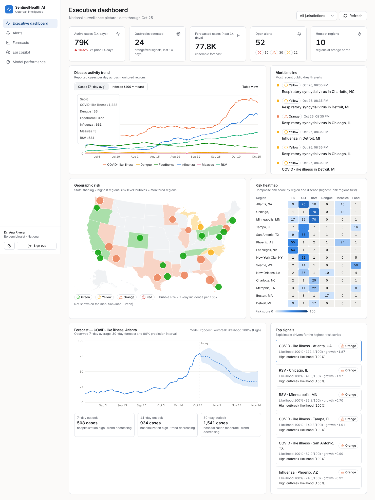

# SentinelHealth AI

**Intelligent disease outbreak detection and forecasting for public health agencies.**

SentinelHealth AI combines healthcare, laboratory, pharmacy, wastewater and public surveillance feeds to:

- detect early outbreak signals
- forecast disease spread 7, 14 and 30 days ahead
- assign explainable Green / Yellow / Orange / Red risk levels
- notify the right epidemiologists, health departments, CDC analysts and healthcare networks
- answer questions through a cited RAG copilot



## Why

Outbreaks are often detected late. Surveillance data is spread across providers, labs, pharmacies and agencies, it arrives late and in inconsistent formats, and traditional aberration detection runs on confirmed cases that reach the health department about a week after onset. SentinelHealth normalizes every feed into one daily signal model, using leading indicators (syndromic ED visits, wastewater, OTC sales) alongside cases, and runs calibrated ML on top.

On the built-in synthetic validation set:

| | Traditional (EARS C2 on lagged cases) | SentinelHealth |
|---|---|---|
| Outbreaks detected | 81% | **100%** |
| Median lead time vs. traditional | — | **12 days earlier** |
| False alerts per series-year | 6.9 | **0.58** |
| Outbreak classifier | — | ROC AUC 0.964 · F1 0.844 |
| 14-day forecast error vs. persistence | — | **42% lower MAE** |

These numbers come from synthetic data and validate the method and pipeline only. See the [model evaluation report](docs/model-evaluation-report.md) for the full metrics and the real-data validation plan.

## Features

| Capability | Implementation |
|---|---|
| Anomaly detection | Isolation Forest, One-Class SVM and Autoencoder (PyTorch, or an sklearn fallback) in a rank-averaged ensemble with direction gating; CDC EARS C2 baseline |
| Outbreak likelihood | LightGBM (XGBoost challenger), isotonic-calibrated, High/Medium/Low tiers, TreeSHAP drivers on every prediction |
| Forecasting | Persistence baseline, global XGBoost (direct multi-horizon), LSTM, Prophet, ensemble; split-conformal 80% intervals; hospitalization and mortality risk |
| Spatial clusters | HDBSCAN / DBSCAN (haversine) on tract centroids, with relative risk against a baseline window |
| Alerts | Transparent risk engine with reasons, 7-day de-duplication with escalation, routing by level and jurisdiction (in-app, SES, SNS SMS, signed webhooks) |
| AI copilot | Hybrid BM25 + vector retrieval with RRF, live surveillance facts, Claude → OpenAI → offline fallback chain, citations, PHI scrubbing, situation reports |
| Data platform | FastAPI + PostgreSQL 16 (PostGIS, pgvector, TimescaleDB when available), Kimball warehouse, Airflow ingestion (CDC, WHO, HealthData.gov, partner feeds), medallion S3 lake |
| Security | RBAC + jurisdiction ABAC, append-only audit log, field-level encryption, KMS everywhere, TLS-only, data lineage, WAF, HIPAA conformance pack |
| Cloud | Terraform for AWS: ECS Fargate, RDS, S3, Lambda, API Gateway, CloudWatch, OpenSearch, MWAA, CloudTrail, GuardDuty |

## Quick start

```bash
cp .env.example .env
docker compose up --build        # db → migrations + seed → api → web
open http://localhost:3000       # epi@sentinelhealth.dev / ChangeMe!2026
```

Without Docker:

```bash
make install && make seed && make api   # API on :8000 (SQLite)
make web                                 # UI on :3000
make test                                # 48 tests: backend, ML, pipelines
make train                               # retrain models + regenerate the evaluation report
```

## Repository structure

```
sentinelhealth-ai/
├── frontend/          Next.js 15 · TypeScript · Tailwind · shadcn/ui · Recharts · Mapbox · Framer Motion
│   └── src/app/       (app)/ dashboard, alerts, forecasts, copilot, models, audit · login · bff/ (auth proxy)
├── backend/           FastAPI service
│   ├── app/api/v1/    auth, surveillance, analytics, alerts, dashboard, copilot, admin
│   ├── app/services/  analytics (scan), forecasting, risk, notifications, dashboard, copilot/ (RAG)
│   ├── app/core/      config, security (JWT, scrypt, Fernet), RBAC, audit middleware, model sync
│   └── alembic/       0001 operational · 0002 Kimball warehouse · 0003 roles & RLS
├── ml/sentinel_ml/    data (synthetic), features, anomaly, forecasting, classification, spatial,
│                      evaluation, registry, pipelines/train_all.py
├── airflow/           DAGs: ingest_public_sources, ingest_partner_feeds, surveillance_pipeline,
│                      model_retraining · plugins/sentinel_connectors · sql/load_warehouse.sql
├── infrastructure/    terraform/{modules,stack,environments/{dev,prod}} · lambda/
├── docs/              architecture, schema, API, ML, RAG, security, deployment, roadmap, scaling, testing
├── tests/             backend/, ml/, pipeline/
├── data/              synthetic sample, warehouse notes
├── notebooks/         01_outbreak_detection_walkthrough.ipynb
├── .github/workflows/ ci.yml, cd.yml
├── docker-compose.yml · Makefile
└── README.md
```

## Documentation

| # | Deliverable | Document |
|---|---|---|
| 1 | System architecture diagram | [docs/architecture.md](docs/architecture.md) |
| 2 | Database schema, ERD, star schema, migrations | [docs/database-schema.md](docs/database-schema.md) · [migrations](backend/alembic/versions) |
| 3 | Repository structure | this README |
| 4 | Backend API design | [docs/api/README.md](docs/api/README.md) · [openapi.json](docs/api/openapi.json) |
| 5 | ML pipeline design | [docs/ml-pipeline.md](docs/ml-pipeline.md) |
| 6 | Dashboard wireframes | [docs/dashboard-wireframes.md](docs/dashboard-wireframes.md) |
| 7 | Terraform infrastructure | [infrastructure/](infrastructure/README.md) |
| 8 | CI/CD workflow | [.github/workflows](.github/workflows) |
| 9-10 | Detection and forecasting models + evaluation report | [ml/sentinel_ml](ml/sentinel_ml) · [docs/model-evaluation-report.md](docs/model-evaluation-report.md) |
| 11 | RAG copilot architecture | [docs/rag-copilot.md](docs/rag-copilot.md) |
| 12 | Security model | [docs/security-model.md](docs/security-model.md) |
| 13 | Deployment guide | [docs/deployment-guide.md](docs/deployment-guide.md) |
| 14 | Product roadmap | [docs/roadmap.md](docs/roadmap.md) |
| 15 | MVP → enterprise scaling | [docs/scaling-strategy.md](docs/scaling-strategy.md) |
| — | Testing strategy | [docs/testing-strategy.md](docs/testing-strategy.md) |

## Status & limitations

- The models were trained and evaluated on **synthetic** data. Validate them retrospectively on a jurisdiction's own data before operational use.
- Public-source connectors (CDC NNDSS/NWSS, HealthData.gov, WHO FluNet/GHO) take their dataset IDs from Airflow Variables. Check the current IDs and column mappings when you onboard. Live calls to these portals were not exercised from the build environment.
- Amazon RDS does not provide TimescaleDB; the migrations detect this and degrade gracefully (see [schema docs](docs/database-schema.md#3-timescaledb-vs-amazon-rds)).
- HIPAA compliance also requires organizational safeguards (BAAs, policies, risk analysis); see the [security model](docs/security-model.md#7-production-checklist).
