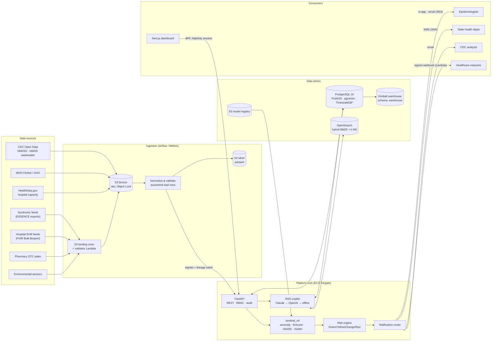
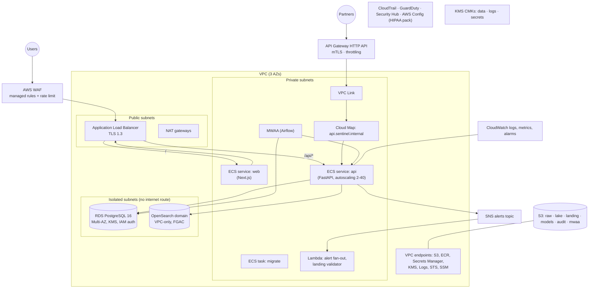
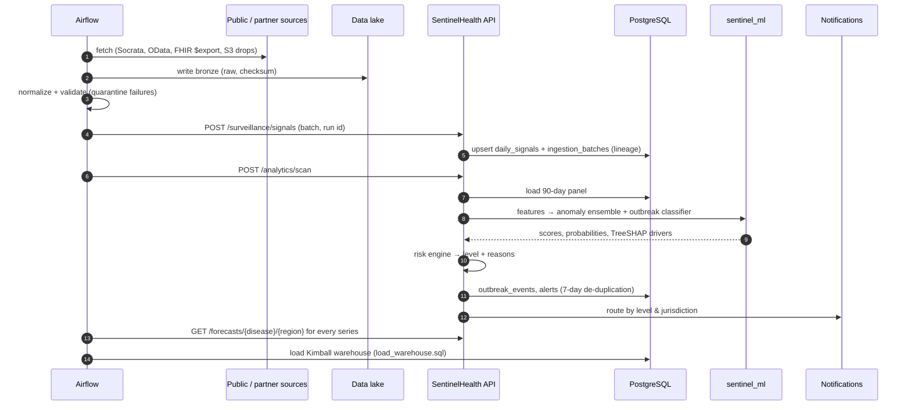

# System architecture

SentinelHealth AI ingests fragmented surveillance feeds, normalizes them into one time-series model, and runs detection, forecasting and risk scoring on top. It alerts the right people and gives epidemiologists an explainable copilot over all of it.

## 1. Logical architecture

\* TimescaleDB runs when the server provides it (self-managed or Timescale Cloud). On Amazon RDS, which does not ship TimescaleDB, the migrations fall back to BRIN-indexed tables and plain materialized views. See [database-schema.md](database-schema.md#timescaledb-vs-amazon-rds).

## 2. AWS deployment architecture

Terraform for all of the above lives in [`infrastructure/terraform`](../infrastructure/terraform). It has one module per concern, a `stack` that composes them, and `environments/dev` and `environments/prod`.

## 3. Request and data flows

### 3.1 Daily surveillance cycle

### 3.2 Interactive request

The browser never holds the API token. Next.js BFF routes (`/bff/*`) exchange credentials for a JWT, which is stored in an `httpOnly; Secure; SameSite=Strict` cookie. Each request is then proxied to the API with the bearer token attached. The API checks the JWT, then RBAC permission and jurisdiction scope, and then writes an audit record for the request.

## 4. Components

| Component | Tech | Responsibility |
|---|---|---|
| `frontend/` | Next.js 15, TypeScript, Tailwind, shadcn/ui, Recharts, Mapbox GL (with offline SVG fallback), Framer Motion | Executive dashboard, alerts triage, forecasts, copilot, model performance, audit log |
| `backend/` | FastAPI, SQLAlchemy 2 (async), Pydantic v2, Alembic | REST API, auth/RBAC, audit, lineage, scan orchestration, notification routing, RAG copilot |
| `ml/` (`sentinel_ml`) | pandas, NumPy, scikit-learn, XGBoost, LightGBM, PyTorch (optional), Prophet (optional) | Synthetic data, features, anomaly detectors, forecasters, outbreak classifier, spatial clustering, evaluation, registry |
| `airflow/` | Apache Airflow 2.10 (MWAA) | Ingestion DAGs, daily surveillance pipeline, warehouse ETL, weekly retraining |
| `infrastructure/` | Terraform, AWS Lambda | VPC, KMS, S3 lake, RDS, ECS/Fargate, ALB+WAF, API Gateway, OpenSearch, MWAA, CloudWatch, CloudTrail/GuardDuty/Config |

## 5. Key design decisions

| Decision | Rationale |
|---|---|
| Wide daily-signal table (`daily_signals`) as the analytical core | Each feed contributes a metric to the same `(date, region, disease)` row via partial upsert, which fixes the "inconsistent formats" problem at the boundary. |
| Global ML models with scale-free features (ratios, log-differences) | One model generalizes across regions of very different size and transfers to newly onboarded jurisdictions. |
| Rule-based risk engine on top of ML scores | Epidemiologists can audit why a level was assigned. Thresholds are policy, owned by the agency, not by the model. |
| Copilot provider chain: Claude → OpenAI → offline template | Keeps working during provider outages or in air-gapped deployments. Output is always grounded in cited facts and sources. |
| BFF with httpOnly cookie | Tokens are never exposed to browser JavaScript, which mitigates token theft through XSS. |
| Medallion lake with immutable bronze zone | Raw evidence can be reproduced, which supports data lineage and after-action review. |
