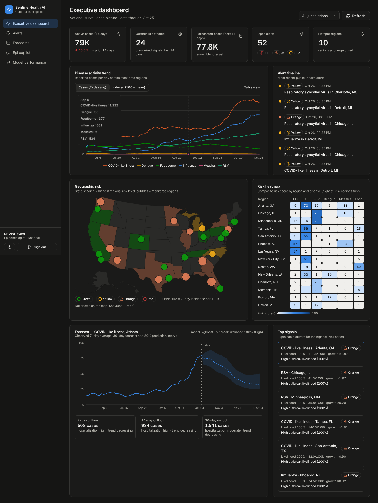
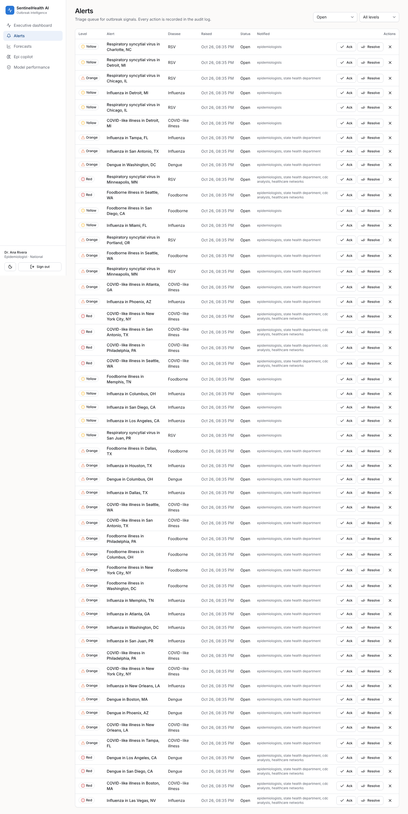
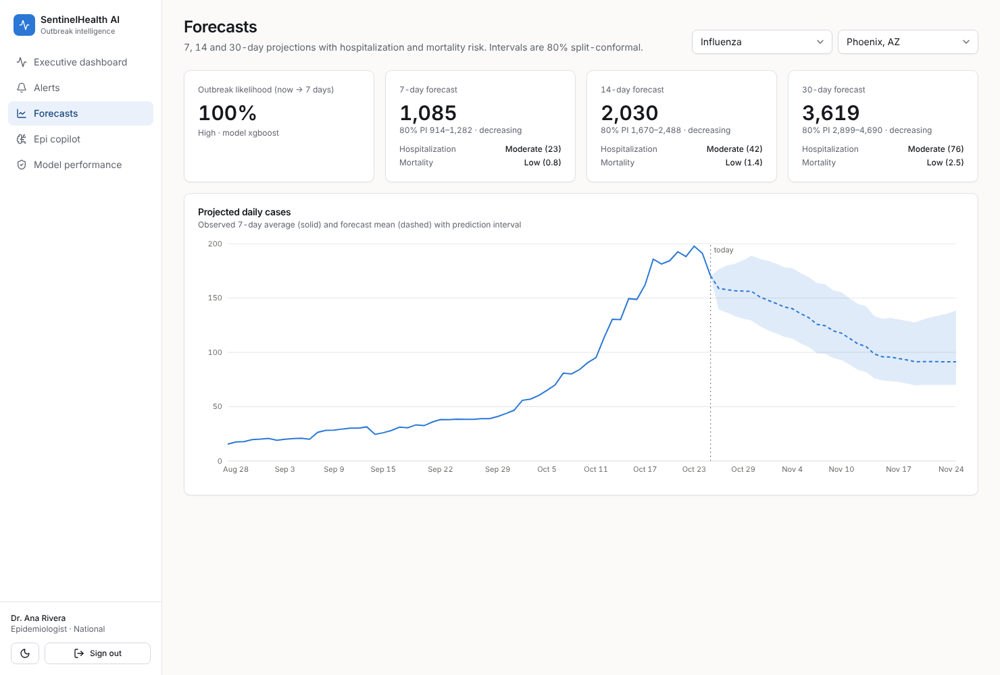
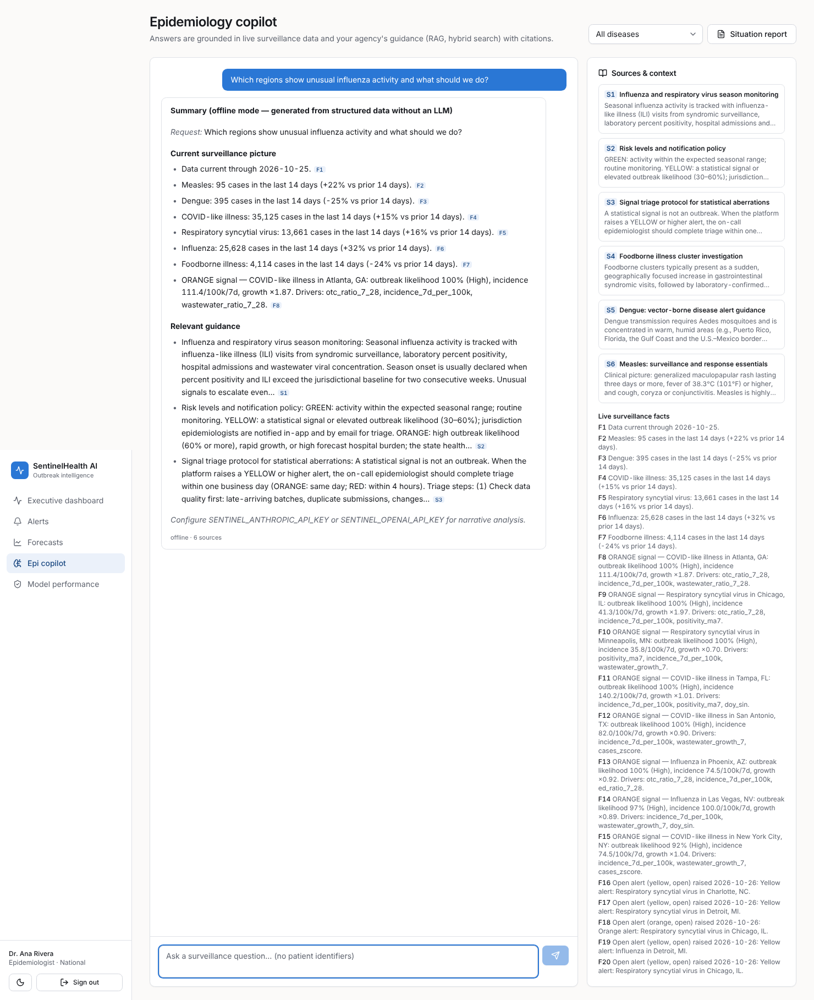
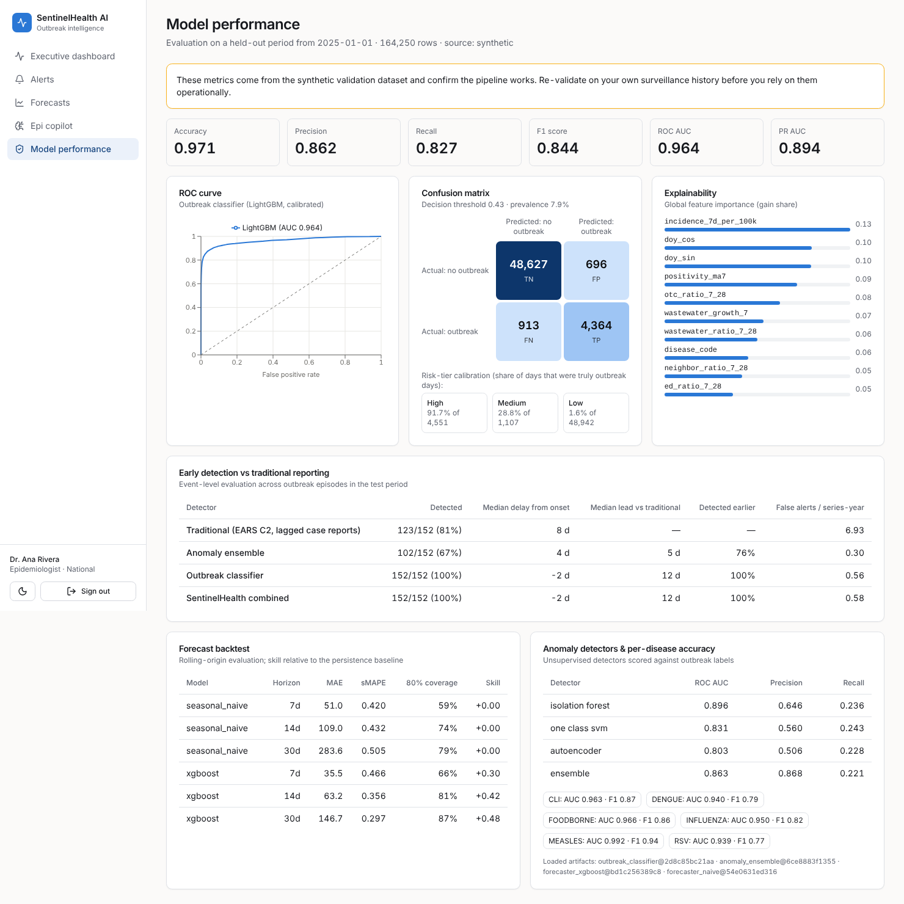

# Dashboard wireframes

These wireframes are implemented in `frontend/`. The screenshots were captured from the running app with synthetic data.

## Executive dashboard (`/`)

```
┌──────────────┬───────────────────────────────────────────────────────────────────────────────┐
│ ◉ Sentinel   │ Executive dashboard                         [All jurisdictions ▾] [⟳ Refresh] │
│  Health AI   │ National surveillance picture · data through Oct 25                           │
│              ├───────────┬───────────┬───────────┬───────────────┬────────────────────────────┤
│ ▸ Dashboard  │ Active    │ Outbreaks │ Forecast  │ Open alerts   │ Hotspot regions            │
│   Alerts     │ cases 79K │ detected  │ 14d 77.8K │ 52            │ 10                         │
│   Forecasts  │ ▲16.5%    │ 24        │           │ ⓘ10 △30 ⓘ12   │                            │
│   Copilot    ├───────────┴───────────┴───────────┴───────┬───────┴────────────────────────────┤
│   Models     │ Disease activity trend   [Cases|Indexed] [Table] │ Alert timeline              │
│   Audit*     │  ╱╲___/‾‾\__  multi-line, 1 colour/disease       │ ● △ Orange  RSV, Chicago    │
│              │  legend: Flu · CLI · RSV · Dengue · Measles · …  │ ● ⓘ Yellow  Flu, Detroit    │
│              ├──────────────────────────────────┬───────────────┴────────────────────────────┤
│              │ Geographic risk (choropleth)     │ Risk heatmap  region × disease (score)     │
│              │  US states shaded by max level   │  Atlanta  │ 9 │70 │10 │ 6 │13 │ 1 │       │
│              │  ● bubbles = regions (incidence) │  Chicago  │ 1 │ 1 │70 │ 0 │13 │ 1 │       │
│              │  legend: ✓Green ⓘYellow △Orange ⊘Red                                          │
│              ├──────────────────────────────────┴───────────────┬────────────────────────────┤
│ Dr. A Rivera │ Forecast — CLI, Atlanta     model · likelihood   │ Top signals (explainable)  │
│ Epidemiolog. │  observed ── | forecast - - - ░ 80% interval     │ CLI · Atlanta   △ Orange   │
│ [☾] [Sign out│  [7-day 508] [14-day 934] [30-day 1,541]         │ likelihood 100% · ×1.87    │
└──────────────┴──────────────────────────────────────────────────┴────────────────────────────┘
```


Dark mode is a separately designed theme, with its own validated categorical steps:



### Visual encoding rules
- **Disease = categorical colour, fixed order** (Influenza → slot 1, CLI → slot 2, …). Colour follows the disease and never its rank. The palette was validated for colour-vision deficiency in both themes; the light theme pairs a legend with a table view to cover the contrast warning.
- **Risk level = reserved status palette.** Every status colour is paired with an **icon and a text label**, so colour never carries meaning alone.
- **Magnitude = single-hue sequential ramp** (heatmap, confusion matrix).
- **No dual axes.** Diseases with very different volumes are compared with the *Indexed (100 = mean)* toggle instead.

## Alerts triage (`/alerts`)

```
Alerts                                            [Open ▾] [All levels ▾]
┌────────┬───────────────────────────────┬──────────┬──────────┬────────┬───────────┬─────────────────┐
│ Level  │ Alert                         │ Disease  │ Raised   │ Status │ Notified  │ Actions         │
├────────┼───────────────────────────────┼──────────┼──────────┼────────┼───────────┼─────────────────┤
│ ⊘ Red  │ Measles in Houston, TX        │ Measles  │ Oct 26   │ open   │ epi, state│ [✓Ack][Resolve]✕│
│  ▼ Why: outbreak likelihood 93% (High) … Top drivers: ed_ratio_7_28 (+1.2) …                       │
└────────┴───────────────────────────────┴──────────┴──────────┴────────┴───────────┴─────────────────┘
```



## Forecasts (`/forecasts`)



## Epidemiology copilot (`/copilot`)

The chat sits on the left. On the right, the "Sources & context" panel shows the retrieved documents `[S#]` and the live surveillance facts `[F#]` behind the answer.



## Model performance (`/models`)

This page shows the metrics, ROC curve, confusion matrix, calibration, feature importance, early detection against traditional reporting, the forecast backtest and the anomaly-detector comparison.


