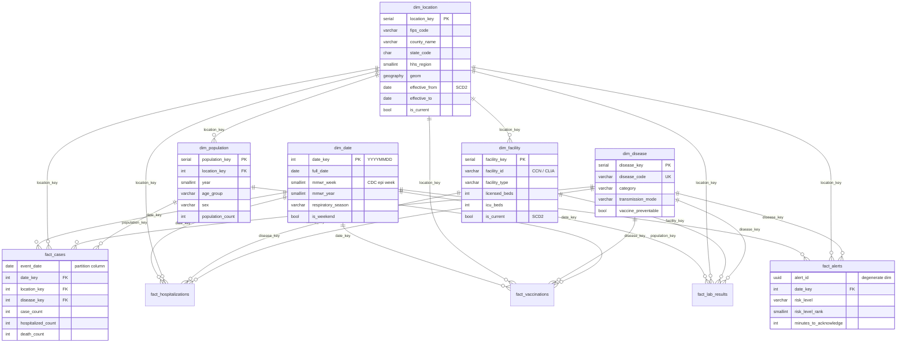

# Database schema

There are two layers in one PostgreSQL 16 cluster:

1. **Operational (OLTP)** in the `public` schema. Ingestion, the API, alerts and the copilot use it.
2. **Kimball data warehouse** in the `warehouse` schema. Reporting, BI and model training use it.

The schema is created by these migration scripts:

| Migration | Contents |
|---|---|
| [`0001_operational_schema.py`](../backend/alembic/versions/0001_operational_schema.py) | Extensions (PostGIS, pgvector, pgcrypto, TimescaleDB if available), operational tables, hypertable/BRIN partitioning, weekly continuous aggregate, append-only audit trigger, HNSW vector index and full-text index |
| [`0002_kimball_warehouse.py`](../backend/alembic/versions/0002_kimball_warehouse.py) | Star schema: 5 dimensions, 5 facts, `dim_date` pre-populated 2000-2040 with CDC MMWR epi-weeks, `v_weekly_incidence` view |
| [`0003_security_roles.py`](../backend/alembic/versions/0003_security_roles.py) | Least-privilege roles (`sentinel_api`, `sentinel_etl`, `sentinel_readonly`), IAM auth grant, row-level security on the case line list |

Incremental warehouse load: [`airflow/dags/sql/load_warehouse.sql`](../airflow/dags/sql/load_warehouse.sql). It is idempotent, applies SCD Type 2 to locations, and uses a 35-day window to pick up late-arriving data.

## 1. Operational ERD

```mermaid
erDiagram
  users {
    uuid id PK
    varchar email UK
    varchar role "admin|epidemiologist|cdc_analyst|state_health_officer|healthcare_partner|viewer"
    char jurisdiction "state code, NULL = national"
    varchar hashed_password "scrypt"
  }
  diseases {
    varchar code PK
    varchar name
    varchar category
    varchar icd10
    float severity_weight
  }
  regions {
    varchar id PK "county FIPS"
    varchar name
    char state
    float lat
    float lon
    int population
    geography geom "PostGIS point (generated)"
    geography boundary "MultiPolygon"
  }
  ingestion_batches {
    uuid id PK
    varchar source
    text source_uri "bronze object"
    varchar pipeline_run_id
    char checksum_sha256
    int record_count
    int rejected_count
    varchar submitted_by
  }
  daily_signals {
    bigint id PK
    date observed_on PK "hypertable time column"
    varchar region_id FK
    varchar disease_code FK
    float cases
    float ed_visits
    float admissions
    float deaths
    float positivity
    float otc_sales
    float wastewater
    uuid batch_id FK
  }
  case_reports {
    uuid id PK
    varchar disease_code FK
    varchar region_id FK
    date onset_date
    varchar age_group
    float lat "tract centroid"
    float lon
    geography geom
    varchar patient_ref "Fernet-encrypted"
    uuid batch_id FK
  }
  lab_reports {
    uuid id PK
    varchar disease_code FK
    varchar region_id FK
    date specimen_date
    varchar loinc_code
    varchar result
    varchar lineage
  }
  hospital_admissions {
    uuid id PK
    varchar disease_code FK
    varchar region_id FK
    varchar facility_id
    date admit_date
    bool icu
  }
  outbreak_events {
    uuid id PK
    varchar disease_code FK
    varchar region_id FK
    date detected_on
    varchar risk_level
    float risk_score
    float outbreak_probability
    float anomaly_score
    jsonb explanation "reasons + drivers"
  }
  alerts {
    uuid id PK
    uuid outbreak_event_id FK
    varchar risk_level
    varchar status
    jsonb audiences
    jsonb deliveries
    varchar acknowledged_by
  }
  forecasts {
    uuid id PK
    varchar disease_code FK
    varchar region_id FK
    date origin_date
    int horizon_days
    varchar model
    float cases_total
    float cases_lower
    float cases_upper
    varchar hospitalization_risk
    varchar mortality_risk
  }
  audit_logs {
    bigint id PK
    timestamptz occurred_at
    varchar user_id
    varchar action
    varchar path
    int status_code
    varchar ip_address
  }
  knowledge_documents {
    uuid id PK
    varchar title
    varchar doc_type
    varchar disease_code
  }
  knowledge_chunks {
    bigint id PK
    uuid document_id FK
    text text
    vector embedding "pgvector(384), HNSW"
    tsvector tsv "GIN"
  }

  regions ||--o{ daily_signals : has
  diseases ||--o{ daily_signals : has
  ingestion_batches ||--o{ daily_signals : "lineage"
  ingestion_batches ||--o{ case_reports : "lineage"
  regions ||--o{ case_reports : ""
  diseases ||--o{ case_reports : ""
  regions ||--o{ lab_reports : ""
  regions ||--o{ hospital_admissions : ""
  diseases ||--o{ outbreak_events : ""
  regions ||--o{ outbreak_events : ""
  outbreak_events ||--o{ alerts : raises
  diseases ||--o{ forecasts : ""
  regions ||--o{ forecasts : ""
  knowledge_documents ||--o{ knowledge_chunks : contains
```



## 2. Kimball star schema

Grain of each fact table:

| Fact | Grain | Measures |
|---|---|---|
| `fact_cases` | day × location × disease (× demographic stratum) | case, confirmed, probable, ED visit, hospitalized and death counts |
| `fact_hospitalizations` | day × facility × disease | new and ICU admissions, ventilated, occupancy |
| `fact_vaccinations` | day × location × disease (vaccine target) × stratum | doses, series completed, coverage % |
| `fact_lab_results` | day × location × disease × test type | tests, positives, positivity (generated), sequenced |
| `fact_alerts` | one row per alert (`alert_id` degenerate dimension) | risk score, probability, anomaly score, minutes to acknowledge, `alert_count` |



### Example analytical query

```sql
-- Weekly cases and incidence per 100k by county, current respiratory season
SELECT v.mmwr_year, v.mmwr_week, v.state_code, v.county_name, v.disease_code, v.cases, round(v.incidence_per_100k, 1)
FROM warehouse.v_weekly_incidence v
JOIN (SELECT DISTINCT mmwr_year, mmwr_week FROM warehouse.dim_date WHERE respiratory_season = '2026-2027') s
  USING (mmwr_year, mmwr_week)
WHERE v.disease_code = 'INFLUENZA'
ORDER BY v.mmwr_year, v.mmwr_week, v.incidence_per_100k DESC;

-- Alert operations: median minutes to acknowledge by level and month
SELECT d.year, d.month, a.risk_level,
       percentile_cont(0.5) WITHIN GROUP (ORDER BY a.minutes_to_acknowledge) AS median_minutes_to_ack,
       sum(a.alert_count) AS alerts
FROM warehouse.fact_alerts a JOIN warehouse.dim_date d USING (date_key)
GROUP BY 1, 2, 3 ORDER BY 1, 2, 3;
```

## 3. TimescaleDB vs Amazon RDS

Amazon RDS for PostgreSQL supports PostGIS and pgvector but **not** the TimescaleDB extension. The migrations handle both cases through the helper function `sentinel_time_partition()`:

| Capability | TimescaleDB present (self-managed / Timescale Cloud / local Docker) | Amazon RDS |
|---|---|---|
| `daily_signals`, fact tables | Hypertables (90-180 day chunks), native compression after 180 days | Regular tables + BRIN index on the time column |
| `daily_signals_weekly` | Continuous aggregate, refreshed hourly by policy | Materialized view, refreshed (`CONCURRENTLY`) by `load_warehouse.sql` |

Both paths were exercised against PostgreSQL 16 during development: the `timescale/timescaledb-ha:pg16` image, and a stock PostgreSQL 16 with PostGIS and pgvector. To get hypertables in AWS, point `SENTINEL_DATABASE_URL` at a Timescale Cloud service peered to the VPC. The application code is identical either way.

## 4. Scale considerations

- At national county scale (3,143 counties × ~20 conditions × 365 days) `daily_signals` grows by about 23M rows per year. That is comfortable for hypertables or BRIN-indexed tables with time-bounded queries.
- `case_reports` is the largest table. Partition it by `onset_date` (monthly) when it passes about 100M rows. The `geom` GiST index supports radius queries for cluster drill-down.
- Read replicas (`db_read_replicas` in Terraform) serve the dashboard and warehouse queries. The primary handles ingestion and alerting.
