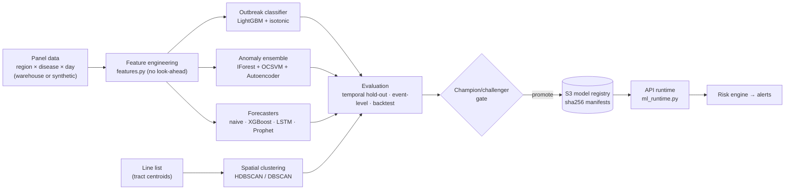

# ML pipeline design

All models live in the `sentinel_ml` package ([`ml/`](../ml)). It is shared by the API (real-time scoring), Airflow (retraining) and the notebooks. One command reproduces training and evaluation:

```bash
python -m sentinel_ml.pipelines.train_all --out ml/artifacts --report docs/model-evaluation-report.md
```

Results are in the **[model evaluation report](model-evaluation-report.md)**, which covers the confusion matrix, accuracy, precision, recall, F1, the ROC curve, early-detection lead time, forecast backtests and hotspots.

## 1. Pipeline



## 2. Data

| Source | Use |
|---|---|
| `sentinel_ml.data.synthetic` | Synthetic generator: 25 US regions × 6 diseases × 3 years, seasonal baselines, negative-binomial noise, weekday reporting effects, labelled outbreaks that spread to neighbouring regions. Each feed has a realistic timing relative to the true epidemic curve: ED visits lead by ~2 days, wastewater and OTC sales lead by ~5 days, admissions lag by ~3 days, deaths lag by ~10 days. |
| Warehouse export (`model_retraining` DAG) | Real jurisdiction data with labels from confirmed `outbreak_events` (status `confirmed`). If there are fewer than 200 labelled outbreak days, training falls back to synthetic augmentation. |

Diseases monitored: influenza, COVID-like illness, RSV, measles (additive outbreaks on a near-zero baseline, severity-weighted), dengue (latitude-dependent), foodborne illness.

## 3. Features (`features.py`)

All features at day *t* use only data available at *t*; `tests/ml/test_ml.py::test_features_have_no_lookahead` enforces this. Ratios make the features scale-free, so a single global model works for New York City and for a county of 50,000 people.

| Feature | Definition |
|---|---|
| `cases_ratio_7_28`, `ed_ratio_7_28`, `admissions_ratio_7_28`, `otc_ratio_7_28`, `wastewater_ratio_7_28` | 7-day mean ÷ the 28-day baseline that ended 7 days earlier |
| `*_growth_7` | 7-day mean ÷ the 7-day mean one week earlier |
| `cases_zscore` | EARS-style z-score of the 7-day mean against the lagged baseline |
| `incidence_7d_per_100k` | 7-day incidence rate |
| `positivity_ma7`, `positivity_delta_7` | Lab positivity level and weekly change |
| `neighbor_ratio_7_28` | Mean case ratio across regions within 900 km (spatial spread) |
| `doy_sin`, `doy_cos`, `disease_code` | Seasonality and disease identity |

## 4. Models

### 4.1 Outbreak likelihood classifier (High / Medium / Low)
- **Target:** an outbreak is active now or begins within 7 days.
- **Model:** LightGBM, with an XGBoost challenger. Isotonic calibration is fitted on a time-ordered calibration window, and the operating threshold maximizes F1 on that window.
- **Tiers:** High ≥ 0.60, Medium 0.30–0.60, Low < 0.30. On the test set, 91.7% of High-tier days and 1.6% of Low-tier days were real outbreak days, so the tiers are calibrated.
- **Explainability:** per-prediction TreeSHAP contributions (`pred_contrib`) are surfaced as alert "drivers".

### 4.2 Anomaly detection (unsupervised)
- `IsolationForestDetector`, `OneClassSVMDetector` (RBF, subsampled for O(n²) cost) and `AutoencoderDetector` (PyTorch 13→16→4→16→13 when installed, otherwise an sklearn MLP autoencoder).
- `EnsembleAnomalyDetector` converts each score to its empirical percentile in the training distribution, averages them, and **gates on direction**: only increases in cases, ED visits, wastewater or OTC sales can alert.
- `EARSC2Detector` / `ears_c2()` implement CDC's EARS C2 as the traditional baseline.

### 4.3 Forecasting (7 / 14 / 30 days)
- **Target:** 7-day average of daily cases, modelled as the log-ratio to the current level.
- `SeasonalNaiveForecaster`: the persistence baseline that every other model must beat.
- `XGBoostForecaster`: a global direct multi-horizon model (horizon as a feature), with lags, multi-source context features and target-date seasonality.
- `LSTMForecaster` (PyTorch): a sequence model over 56 days of log activity, predicting a 30-step vector.
- `ProphetForecaster`: per-series yearly seasonality.
- `EnsembleForecaster`: median of the members.
- **Intervals:** split-conformal 80% prediction intervals per horizon, which need no distributional assumptions.
- **Derived risk** (`forecasting/risk.py`): expected admissions and deaths come from forecast cases × the observed severity ratio, shrunk toward disease priors (empirical Bayes, k = 200). Per-100k thresholds map them to low / moderate / high / very high.

### 4.4 Spatial cluster detection
- HDBSCAN (leaf selection, with fringe points of membership < 0.5 treated as noise) or DBSCAN with a haversine metric, run on census-tract centroids of recent cases.
- **Relative risk** = (observed + 1) / (expected + 1), where *expected* is the baseline-window density inside the cluster radius, scaled by window length. Clusters with RR ≥ 1.5 are reported as hotspots.

## 5. Validation methodology

| Level | Method | Why |
|---|---|---|
| Day-level | Temporal hold-out (train < 2025-01-01 ≤ test). Accuracy, precision, recall, F1, ROC AUC, PR AUC, confusion matrix. | Standard classification quality, without leakage across time |
| Event-level | Each outbreak episode: was it detected, how many days after onset, and how many days **before the traditional EARS C2 signal on 7-day-lagged confirmed cases**. False alerts per series-year. | Measures what matters operationally: earlier detection and alert burden |
| Forecast | Rolling-origin backtest every 14 days: MAE, sMAPE, 80% interval coverage, skill vs persistence | Honest out-of-sample accuracy at each horizon |
| Calibration | Observed outbreak rate per risk tier | Tiers must mean what they say |

**Headline results** on synthetic data (not evidence of real-world performance; see the provenance note in the report):

- Classifier: ROC AUC 0.964, F1 0.844, precision 0.862, recall 0.827.
- Early detection: the combined detector caught all 152 test outbreaks, with a **median of 12 days before traditional reporting** and 0.58 false alerts per series-year. The traditional baseline caught 81%, with 6.9 false alerts per series-year.
- Forecasting: XGBoost beats persistence by 30% (7-day), 42% (14-day) and 48% (30-day) on MAE.

**Known limitations:**
- Synthetic leading indicators are cleaner than real feeds.
- Calendar features rank highly because the synthetic outbreak rate is seasonal. Real-data validation should test ablations without them.
- The 7-day intervals under-cover (66% against an 80% nominal), so widen them or recalibrate per disease.

## 6. MLOps

| Concern | Implementation |
|---|---|
| Registry | `sentinel_ml.registry`: joblib artifacts with a JSON manifest (sha256, version, metrics, train window). The API refuses an artifact whose checksum doesn't match. |
| Retraining | `model_retraining` DAG runs weekly. A champion/challenger gate requires no AUC regression, no drop in forecast skill, and no more than +10% false alerts. Promotion goes to `s3://…-models/champion/` and triggers an ECS rolling restart. |
| Serving fallbacks | No artifact → transparent heuristic classifier, EARS C2 anomaly detection and persistence forecasts (`ml_runtime.py`), so the platform degrades gracefully. |
| Monitoring | Input drift (PSI on feature distributions), alert precision measured from analyst adjudications (acknowledged / resolved / dismissed), and forecast coverage tracked in the warehouse (`fact_alerts`, `forecasts`). |
| Reproducibility | Seeds are fixed, raw inputs are immutable in the bronze lake, and each training run records its data window and code version. |
