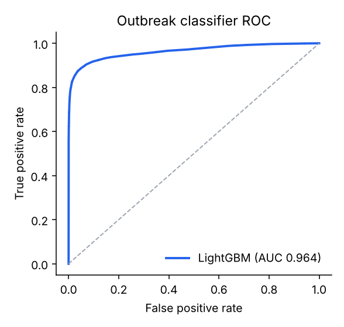
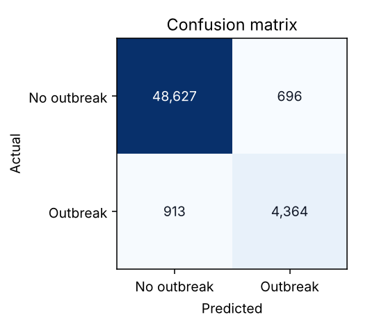
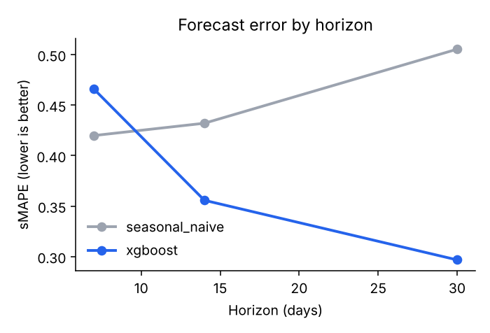

# SentinelHealth AI — Model Evaluation Report

_Generated 2026-10-26 19:57 UTC by `sentinel_ml.pipelines.train_all` (runtime 216.1 s). Re-run with `make train` to reproduce._

> **Data provenance.** Unless stated otherwise these results come from the built-in synthetic surveillance generator (`sentinel_ml.data.synthetic`), which injects labelled outbreaks into seasonal baselines across multiple feeds. Synthetic results validate the pipeline and relative model behaviour; they are **not** evidence of real-world performance. Before operational use, models must be re-validated on jurisdictional data with retrospective outbreak line lists (see `docs/ml-pipeline.md` §Validation).

## 1. Dataset

| Item | Value |
|---|---|
| Source | synthetic |
| Rows (region × disease × day) | 164,250 |
| Series | 150 |
| Train rows / Test rows | 103,350 / 54,600 |
| Temporal split | train < 2025-01-01 ≤ test |
| Outbreak-day prevalence (test) | 7.9% |

## 2. Outbreak likelihood classifier (LightGBM, isotonic-calibrated)

Target: outbreak active now or starting within 7 days. Operating threshold chosen to maximise F1 on a time-ordered calibration window (no test leakage).

| Metric | Value |
|---|---|
| Accuracy | 0.971 |
| Precision | 0.862 |
| Recall | 0.827 |
| F1 score | 0.844 |
| ROC AUC | 0.964 |
| PR AUC (average precision) | 0.894 |
| Decision threshold | 0.43 |

**Confusion matrix (test set)**

| | Predicted: no outbreak | Predicted: outbreak |
|---|---|---|
| **Actual: no outbreak** | 48,627 (TN) | 696 (FP) |
| **Actual: outbreak** | 913 (FN) | 4,364 (TP) |

 

**Risk tier calibration** — share of days in each tier that were truly outbreak days:

| Tier | Probability | Days | Observed outbreak rate |
|---|---|---|---|
| High | ≥ 0.60 | 4,551 | 91.7% |
| Medium | 0.30 – 0.60 | 1,107 | 28.8% |
| Low | < 0.30 | 48,942 | 1.6% |

Challenger XGBoost classifier: AUC 0.964, F1 0.834, precision 0.825, recall 0.844.

**Per-disease performance**

| Disease | ROC AUC | F1 |
|---|---|---|
| CLI | 0.963 | 0.872 |
| DENGUE | 0.940 | 0.793 |
| FOODBORNE | 0.966 | 0.863 |
| INFLUENZA | 0.950 | 0.819 |
| MEASLES | 0.992 | 0.938 |
| RSV | 0.939 | 0.773 |

**Top features (gain share)**: `incidence_7d_per_100k` (0.13), `doy_cos` (0.10), `doy_sin` (0.10), `positivity_ma7` (0.09), `otc_ratio_7_28` (0.08), `wastewater_growth_7` (0.07), `wastewater_ratio_7_28` (0.06), `disease_code` (0.06), `neighbor_ratio_7_28` (0.05), `ed_ratio_7_28` (0.05)

## 3. Anomaly detection (unsupervised)

Day-level scores vs. outbreak labels. Detectors are trained without labels; the ensemble rank-averages components and only flags *increases* in activity.

| Detector | ROC AUC | Precision @ 97th pct | Recall @ 97th pct |
|---|---|---|---|
| isolation_forest | 0.896 | 0.646 | 0.236 |
| one_class_svm | 0.831 | 0.560 | 0.243 |
| autoencoder | 0.803 | 0.506 | 0.228 |
| ensemble | 0.863 | 0.868 | 0.221 |

Autoencoder backend: `sklearn` (PyTorch when installed, scikit-learn MLP otherwise).

## 4. Early detection vs. traditional reporting

Event-level evaluation over outbreak episodes in the test period. *Traditional* = EARS C2 (CDC) on confirmed cases with a 7-day reporting lag. SentinelHealth detectors use syndromic, wastewater, pharmacy and lab feeds with a 1-day lag. Lead time = days earlier than the traditional signal (episodes the traditional method missed are credited at outbreak end).

| Detector | Episodes detected | Median delay from onset (days) | Median lead vs traditional (days) | Detected earlier | False alerts / series-year |
|---|---|---|---|---|---|
| traditional_ears | 123/152 (80.9%) | 8.0 | — | — | 6.93 |
| ensemble | 102/152 (67.1%) | 4.0 | 5.0 | 76.5% | 0.30 |
| classifier | 152/152 (100.0%) | -2.0 | 12.0 | 100.0% | 0.56 |
| sentinel | 152/152 (100.0%) | -2.0 | 12.0 | 100.0% | 0.58 |

## 5. Forecasting (rolling-origin backtest)

Error on total cases over the horizon; intervals are 80% split-conformal. Skill = 1 − MAE/MAE(naive).

| Model | Horizon | MAE | sMAPE | 80% interval coverage | Skill vs naive | Forecasts |
|---|---|---|---|---|---|---|
| seasonal_naive | 7d | 51.0 | 0.420 | 59.0% | +0.000 | 3,600 |
| xgboost | 7d | 35.5 | 0.466 | 65.7% | +0.305 | 3,600 |
| seasonal_naive | 14d | 109.0 | 0.432 | 73.9% | +0.000 | 3,600 |
| xgboost | 14d | 63.2 | 0.356 | 81.3% | +0.420 | 3,600 |
| seasonal_naive | 30d | 283.6 | 0.505 | 79.4% | +0.000 | 3,600 |
| xgboost | 30d | 146.7 | 0.297 | 87.2% | +0.483 | 3,600 |

Top forecaster features: `wastewater_growth_7`, `wastewater_ratio_7_28`, `disease_code`, `cases_ratio_7_28`, `logdiff_28`, `logdiff_7`, `logdiff_21`, `log_level`, `horizon`, `otc_ratio_7_28`

_LSTM and Prophet are implemented (`sentinel_ml.forecasting`) and run automatically when `torch` / `prophet` are installed (`pip install -e 'ml[all]'`); they were not installed for this run._

## 6. Spatial hotspots (HDBSCAN, haversine)

| Disease | Cases | Centroid | Radius (km) | Relative risk |
|---|---|---|---|---|
| CLI | 64 | 32.7282, -117.1642 | 12.67 | 14.31 |
| CLI | 66 | 34.0483, -118.2307 | 10.66 | 6.02 |
| CLI | 57 | 47.0773, -122.435 | 196.95 | 2.21 |
| CLI | 20 | 36.2345, -115.1653 | 54.82 | 2.08 |
| CLI | 15 | 39.9692, -83.2628 | 56.33 | 1.71 |
| CLI | 24 | 42.2972, -82.9665 | 60.89 | 1.71 |
| CLI | 59 | 41.8706, -87.6101 | 74.89 | 1.53 |
| FOODBORNE | 22 | 32.7586, -96.7937 | 29.67 | 3.96 |
| FOODBORNE | 27 | 33.4765, -112.0839 | 9.98 | 2.99 |
| INFLUENZA | 44 | 45.5147, -122.6824 | 10.64 | 8.49 |

## 7. Limitations and governance

- Synthetic labels are cleaner than real outbreak determinations; expect lower real-world precision.
- Thresholds trade sensitivity for alert fatigue; each jurisdiction should tune them (Admin → Alert policy).
- Models are monitored for drift (PSI on inputs, rolling AUC on adjudicated alerts) and retrained weekly by the `model_retraining` Airflow DAG; promotion requires beating the champion on the backtest.
- All predictions ship with feature attributions (TreeSHAP / detector deviations) to support explainability.
