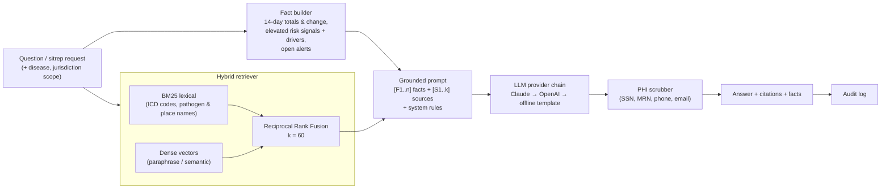

# RAG copilot architecture

The epidemiology copilot explains outbreaks, summarizes trends, answers surveillance questions, and writes situation reports and risk assessments. Every answer is grounded in two kinds of evidence, and both are cited:

1. **Live surveillance facts** `[F#]`, computed from the database at request time and scoped to the user's jurisdiction.
2. **Retrieved guidance** `[S#]` from the agency's knowledge base: case definitions, protocols, HAN bulletins and past situation reports.

## Components

| Piece | File | Notes |
|---|---|---|
| Chunking | `services/copilot/retriever.py::chunk_text` | Paragraph-aware chunks of 180 words with 40-word overlap. The document title is prepended before embedding. |
| Embeddings | `services/copilot/embeddings.py` | Uses OpenAI `text-embedding-3-small` (384-dim) when a key is configured. Otherwise a deterministic signed feature-hashing embedder (unigrams, bigrams, char-trigrams), so retrieval works fully offline in air-gapped deployments. |
| Vector store | `knowledge_chunks.embedding vector(384)` with an HNSW cosine index (pgvector) and a `tsvector` GIN index | MVP: both legs scored in-process over the candidate set (`SQLHybridRetriever`) |
| National scale | `OpenSearchHybridRetriever` | Amazon OpenSearch `hybrid` query (BM25 + k-NN) with a normalization search pipeline. Activated by `SENTINEL_OPENSEARCH_URL`. |
| LLM | `services/copilot/llm.py` | `AnthropicProvider` (default model `claude-sonnet-5-5`, configurable via `SENTINEL_ANTHROPIC_MODEL`), `OpenAIProvider`, `OfflineProvider`. `FallbackChain` tries them in order. |
| Orchestration | `services/copilot/service.py` | `answer()`, `situation_report()`, `index_document()` |

## Guardrails

- **System prompt rules:** ground every statement in the facts and sources, cite `[S#]` and `[F#]`, never invent numbers, distinguish a statistical signal from a confirmed outbreak, and defer decisions to the health officer.
- **No PHI in context:** facts are aggregates only. The copilot never reads `case_reports.patient_ref` or line-list rows.
- **Output PHI scrubbing:** regex redaction runs as defence in depth.
- **Jurisdiction scoping:** facts and alerts are filtered to the caller's state, using the same RBAC as the API.
- **Auditability:** every copilot call is in the audit log with the user and the request. The response includes the exact facts and citations used.
- **Vendor data handling:** use enterprise/zero-retention terms with LLM vendors and sign a BAA if any PHI could be sent. The default design sends only aggregates and public guidance.

## Situation report template

`POST /copilot/sitrep` asks the model for:

1. Key points
2. Epidemiological situation
3. Signals and alerts
4. Outlook (forecast, hospitalization and mortality risk)
5. Recommended actions
6. Data limitations

## Evaluation (recommended)

- **Retrieval:** recall@k on a curated set of question → document pairs from agency SMEs.
- **Groundedness:** an LLM-as-judge check that every numeric claim appears in `[F#]`, plus spot review by epidemiologists.
- **Safety:** red-team prompts for PHI extraction and for off-policy recommendations.
